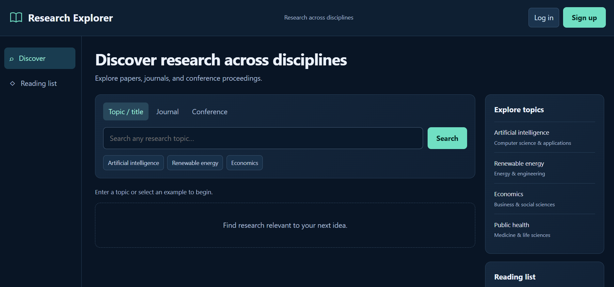

# Research Explorer

A research discovery platform with topic, journal, and conference search,
user accounts, and private reading lists.

## Live Dashboard

[Open Research Explorer](https://37.27.39.68:8002/dashboard)

Search research topics, journals, and conference proceedings, and save papers to your private reading list.


## Features

- Search scholarly publications across research disciplines
- Find journals and conference sources with typing suggestions
- View publication titles, authors, years, and original links
- Create an account and log in
- Save and remove papers in a private reading list
- Access saved papers across devices
- Responsive navy dashboard
- HTTPS deployment with scheduled certificate renewal

## Dashboard Preview

Search by topic or paper title, or select a journal or conference from
the suggestions. Create an account to save papers to a private reading list.

Searches currently display the first ten matches. Selected journals,
conferences, and suggested topics show publications newest first.



## Technologies

Python, FastAPI, asynchronous HTTP requests, SQL, PostgreSQL,
HTML, CSS, JavaScript, Docker Compose, Linux, Caddy, and systemd.

## Accounts and security

- Password hashing using scrypt
- Secure, HttpOnly session cookies
- Server-side sessions with expiration
- Account-specific reading lists
- Origin checks on account and reading-list changes
- Basic authentication attempt limits

Email verification and password recovery are not implemented.
SMTP configuration and an email helper are included from setup work,
but account email delivery is not enabled.

## Deployment

The included configuration describes deployment at
`/opt/research-explorer`.

1. Copy `.env.example` to `.env`.
2. Replace placeholder credentials and API keys.
3. Adapt the hostname, IP address, and allowed origins for your server.
4. Create the PostgreSQL tables used by the application.
5. Provision the IP certificate referenced in `deploy/Caddyfile`.
6. Start the deployment:

```bash
docker compose \
  -f compose.yaml \
  -f compose.https.yaml \
  -f compose.ip.yaml \
  up -d --build --wait
```

Certificate files are stored locally and excluded from Git.
Database tables currently require manual setup.

## Data source

Publication metadata: [OpenAlex](https://openalex.org/).
Coverage and full-text availability vary by publication.

## Project status

Personal software development project.
Saved topics, automated alerts, and pagination are planned.
